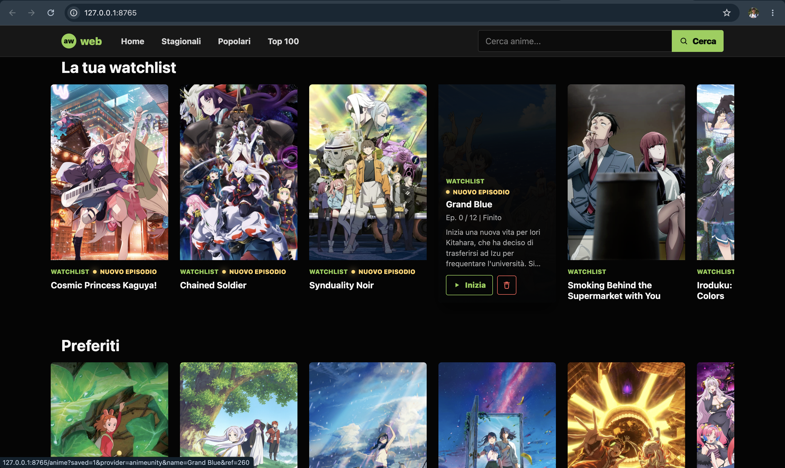
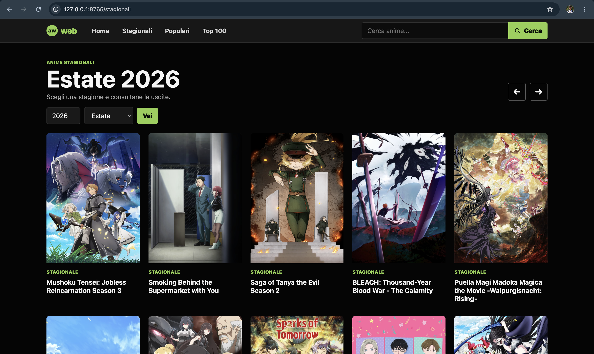

# aw-web






## Indice

- [Installazione](#installazione-su-macos-unico-os-supportato-e-testato-attualmente)
- [Avvio](#avvio)
- [Features](#features)
- [Watchlist, Preferiti e Database](#watchlist-preferiti-e-database)
- [Player MPV](#player-mpv)
- [Sviluppo](#sviluppo)

## Installazione su MacOS (unico OS supportato e testato attualmente)

La guida d'installazione richiede [uv](https://github.com/astral-sh/uv) e [MPV](https://mpv.io/installation/).

Su macOS puoi installare `uv` e `mpv` tramite [Homebrew](https://brew.sh/) con:

```bash
brew install uv mpv
```

Dopo l'installazione di `uv` potrebbe essere necessario aggiornare la shell. Dunque fare:

```bash
uv tool update-shell
```

```bash
exec zsh
```

Puoi installare `aw-web` direttamente da questa repository GitHub tramite `uv`:

```bash
uv python install 3.13
```

```bash
uv tool install --managed-python --python 3.13 git+https://github.com/luigiaceto/aw-web.git
```

il primo comando installa python 3.13 dentro `uv` in modo da non interferire con altre installazioni python di sistema, mentre il secondo comando installa la WebApp come tool globale in un ambiente isolato.

## Avvio

Avvia da terminale il server locale con:

```bash
aw-web
```

L'app verrà aperta nel browser su:

```text
http://127.0.0.1:8765
```

Per fermarla, torna nel terminale e premi `Ctrl+C`.

## Come Aggiornare l'App

Per aggiornare `aw-web` all'ultima versione della repository, eseguire il comando:

```bash
uv tool install --force --managed-python --python 3.13 git+https://github.com/luigiaceto/aw-web.git
```

## Features

Dalla home dell'app puoi:

- vedere gli ultimi episodi usciti;
- consultare gli anime stagionali, popolari e la top-100, tutto grazie ad AniList;
- cercare anime;
- aprire la pagina dettaglio di un anime;
- vedere la tua watchlist;
- vedere i tuoi preferiti;
- vedere a che episodio eri arrivato;
- vedere il badge `Nuovo episodio` quando esiste un episodio successivo all'ultimo visto.

> [!NOTE]
> aw-web si appoggia ad AniList per le liste STAGIONALI, POPOLARI e TOP-100, dunque se si hanno problemi nell'accedere alle pagine STAGIONALI, POPOLARI, TOP-100 con errore HTTP 403 è probabile che la causa derivi proprio da AniList che potrebbe aver temporaneamente sospeso il servizio.

Nella pagina di un anime puoi:

- leggere info e trama;
- vedere la copertina dell'anime;
- aggiungere o rimuovere l'anime dalla watchlist con il pulsante segnalibro;
- aggiungere o rimuovere l'anime dai preferiti con il pulsante cuore;
- scegliere un episodio ed aprirlo in MPV.

## Watchlist, Preferiti e Database

Watchlist, preferiti e cronologia degli episodi visti vengono salvati in un database SQLite locale dentro:

```text
~/.aw-web/web.sqlite3
```

> [!IMPORTANT]
> Il progetto è ancora in fase di sviluppo, dunque potrebbe essere possibile, durante un aggiornamento, che venga cambiata la firma del database (colonne). Dunque può accadere che il database diventi invalido per la nuova versione dell'app, ne segue che occorre resettarlo. Per fare ciò, chiudere l'app ed eseguire nel terminale:
>
> ```bash
> aw-web --reset-db
> ```
>
> Al prossimo avvio dell'app verrà dunque ricreato il database. Il file precedente non viene eliminato: viene rinominato in `~/.aw-web/web.sqlite3.<data-ora>.bak` (un file per ogni reset), quindi i progressi restano recuperabili a mano. Lo sviluppatore si impegna a minimizzare i cambiamenti apportati alla firma del database.
> Si consiglia quindi di non fare affidamente esclusivamente su quest'app per tenere traccia della propria watchlist.

## Player MPV

`aw-web` usa il browser come interfaccia di navigazione e MPV come player video.

Quando clicchi `Guarda`, la WebApp risolve il link dell'episodio e lo apre in MPV.

## Sviluppo

Dalla cartella del progetto, con `uv`:

```bash
uv run aw-web             # avvia l'app dal codice locale
uv run pytest             # test
uv run pyright            # controllo dei tipi
uv run ruff check         # lint
uv run ruff format        # formattazione
```

Struttura del pacchetto `src/aw_web/`:

- `anime.py`: modello (anime, episodi, episodio da riprendere);
- `animeunity.py`: collegamento con AnimeUnity, l'unico provider;
- `anilist.py`, `matching.py`: liste AniList e abbinamento con AnimeUnity;
- `library.py`, `refresh.py`, `db.py`: watchlist, preferiti, cronologia e database SQLite;
- `playback.py`: apertura degli episodi in MPV;
- `web/`: server HTTP, pagine, componenti HTML e file statici (CSS, JS);
- `__main__.py`: riga di comando (`aw-web`, `aw-web --reset-db`).

I test in `tests/` hanno lo stesso ordine: un file per modulo.

## Report di Bug e Problemi Vari

Se nel corso dell'installazione, aggiornamento ed utilizzo dell'applicazione si dovessero riscontrare problemi o bug inerenti ad aw-web si prega di aprire una GitHub issue in modo da dare la possibilità allo sviluppatore di risolvere il problema e applicare l'eventuale bug fix al progetto.
