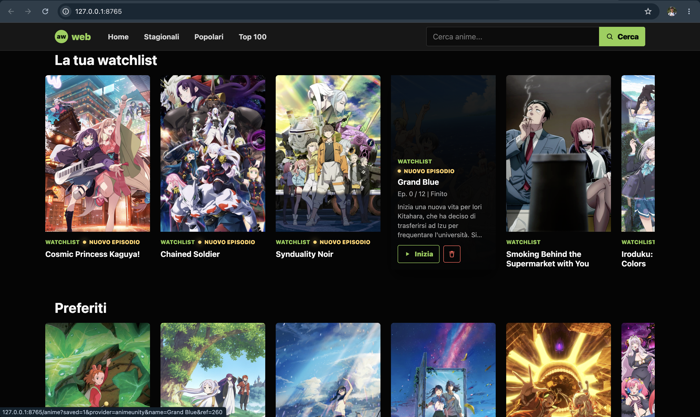
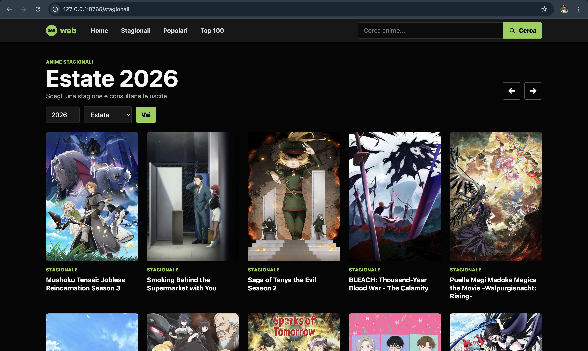

# aw-web






## Indice

- [Installazione](#installazione-su-macos-unico-os-supportato-e-testato-attualmente)
- [Avvio](#avvio)
- [Utilizzo](#utilizzo)
- [Anime Stagionali](#anime-stagionali)
- [Watchlist, Preferiti e Database](#watchlist-preferiti-e-database)
- [Player MPV](#player-mpv)

## Installazione su MacOS (unico OS supportato e testato attualmente)

La guida d'installazione richiede [uv](https://github.com/astral-sh/uv) e [MPV](https://mpv.io/installation/).

Su macOS puoi installare `uv` e `mpv` tramite [Homebrew](https://brew.sh/) con:

```bash
brew install uv mpv
```

Dopo l'installazione di `uv` potrebbe essere necessario aggiornare la shell. Dunque fare:

```bash
uv tool update-shell
```

```bash
exec zsh
```

Puoi installare `aw-web` direttamente da questa repository GitHub tramite `uv`:

```bash
uv python install 3.13
```

```bash
uv tool install --managed-python --python 3.13 git+https://github.com/luigiaceto/aw-web.git
```

il primo comando installa python 3.13 dentro `uv` in modo da non interferire con altre installazioni python di sistema, mentre il secondo comando installa la WebApp come tool globale in un ambiente isolato.

## Avvio

Avvia da terminale il server locale con:

```bash
aw-web
```

L'app verrà aperta nel browser su:

```text
http://127.0.0.1:8765
```

Per fermarla, torna nel terminale e premi `Ctrl+C`.

## Come Aggiornare l'App

Per aggiornare `aw-web` all'ultima versione della repository, eseguire il comando:

```bash
uv tool install --force --managed-python --python 3.13 git+https://github.com/luigiaceto/aw-web.git
```

## Utilizzo

Dalla home dell'app puoi:

- vedere gli ultimi episodi usciti;
- aprire la pagina degli anime stagionali;
- cercare anime;
- aprire la pagina dettaglio di un anime;
- vedere la tua watchlist;
- vedere i tuoi preferiti;
- vedere a che episodio eri arrivato;
- vedere il badge `Nuovo episodio` quando esiste un episodio successivo all'ultimo visto.

Nella pagina anime puoi:

- leggere info e trama;
- vedere la copertina recuperata da AniList;
- aggiungere o rimuovere l'anime dalla watchlist con il pulsante segnalibro;
- aggiungere o rimuovere l'anime dai preferiti con il pulsante cuore;
- scegliere un episodio;
- aprirlo in MPV.

## Anime Stagionali

Dal pulsante `Stagionali` nella barra in alto puoi accedere alla pagina dedicata agli anime stagionali per rimanere aggiornati.

In questa pagina puoi:

- scegliere anno e stagione;
- usare le frecce per andare alla stagione precedente o successiva;
- vedere copertina, generi, numero di episodi e `Voto AniList`;
- cliccare un anime per cercarlo su AnimeUnity e aprirlo nella normale pagina dettaglio di `aw-web`.

## Watchlist, Preferiti e Database

Watchlist, preferiti e cache delle copertine degli anime vengono salvati in un database SQLite locale dentro:

```text
~/.aw-web/web.sqlite3
```

> [!IMPORTANT]
> Il progetto è ancora in fase di sviluppo, dunque potrebbe essere possibile, durante un aggiornamento, che venga cambiata la firma del database (colonne usate). Dunque può accadere che il database diventi invalido per la nuova versione dell'app, ne segue che occorre resettarlo. Per fare ciò, chiudere l'app ed eseguire nel terminale:
>
> ```bash
> aw-web --reset-db
> ```
>
> Al prossimo avvio dell'app verrà dunque ricreato il database nuovo ma perderete tutti i vostri progressi (watchlist e preferiti). Lo sviluppatore si impegna a minimizzare i cambi al database.
> Si consiglia quindi di non fare affidamente esclusivamente su quest'app per tenere traccia della propria watchlist.

## Player MPV

`aw-web` usa il browser come interfaccia e MPV come player video.

Quando clicchi `Guarda`, la WebApp risolve il link dell'episodio e apre MPV direttamente:

```text
aw-web -> MPV -> server video
```

> [!CAUTION]
> Se nel corso dell'installazione, aggiornamento ed utilizzo dell'applicazione si dovessero riscontrare problemi o bug inerenti ad aw-web si prega di aprire una issue in modo da dare la possibilità allo sviluppatore di aiutare con la risoluzione e applicare l'eventuale bug fix al progetto.
